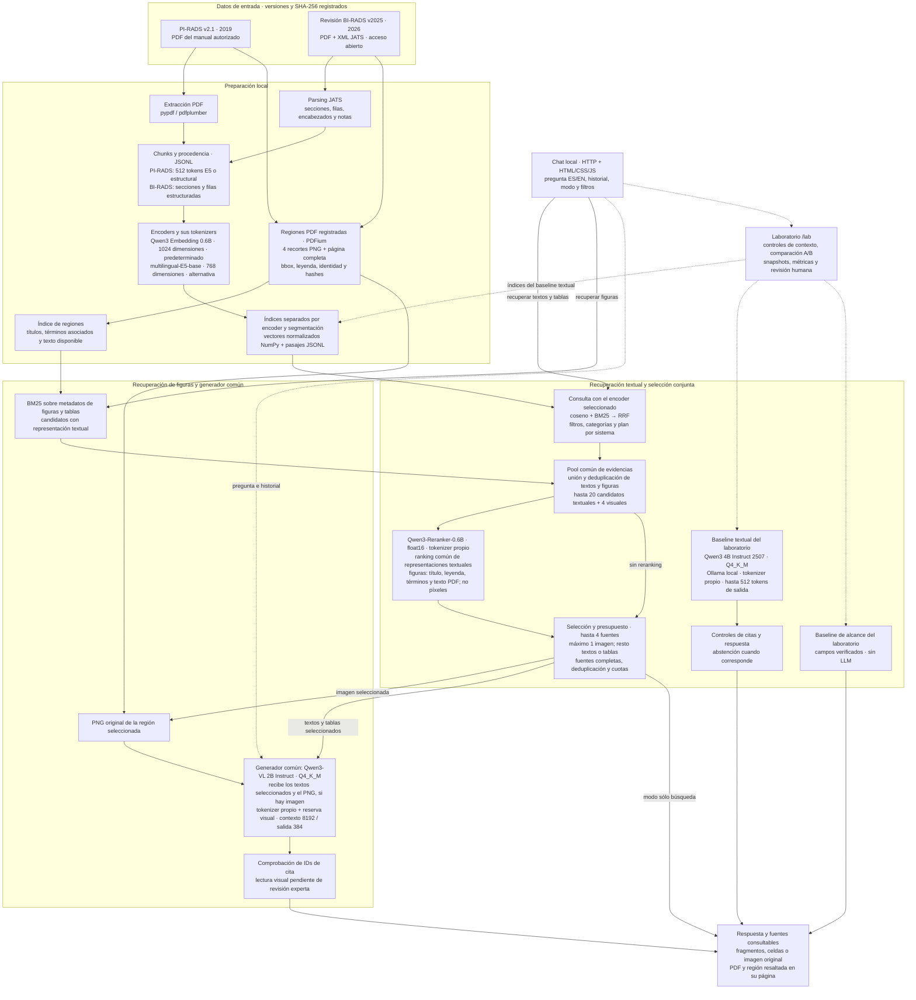

# Radiology Knowledge RAG Lab

RAG multimodal local para consultar textos, tablas e imágenes documentales
mediante un chat con fuentes verificables. Corpus: **PI-RADS v2.1 (2019)** y una
**revisión abierta de 2026 sobre BI-RADS v2025**.
Proyecto experimental, sin validación clínica.

## Arquitectura



El encoder elegido se usa tanto para indexar los pasajes como para representar la
consulta; sus vectores no se mezclan con los del otro encoder. Encoder, reranker
y generador se cargan por turnos. El chat fusiona candidatos textuales y visuales
y usa un único VLM. El reranker compara el texto asociado a las figuras; el VLM
recibe sus PNGs originales cuando se seleccionan. PDFium (`pypdfium2`) renderiza
las páginas y sus regiones registradas para obtener los recortes; no es detección
automática de todas las figuras. OCR y recuperación mediante embeddings visuales quedan
pendientes. Las citas y las trazas permiten inspeccionar la evidencia, sin certificar
la corrección de la respuesta.

| Componente | Implementación |
|---|---|
| Backend / interfaz | Python 3.12, HTTP estándar, HTML/CSS/JavaScript |
| Extracción PDF | pypdf, pdfplumber; render con pypdfium2 |
| Segmentación | PI-RADS: ventanas de 512 tokens E5 o cortes estructurales. BI-RADS: secciones y filas con encabezados y notas |
| Embeddings | Qwen3 Embedding 0.6B, 1024 dimensiones; alternativa multilingual E5 base, 768 dimensiones |
| Índice y búsqueda | NumPy + BM25, fusión RRF y categorías tabulares explícitas; hasta 4 pasajes |
| Reranking | Qwen3-Reranker-0.6B local sobre el pool común; figuras representadas por texto asociado; activado por defecto |
| Generador común | Qwen3-VL 2B Instruct, Q4_K_M, servido por Ollama local; texto y PNG original en una única consulta |
| Baseline de laboratorio | Qwen3 4B Instruct 2507, Q4_K_M; alternativa textual y campos de alcance verificados sin LLM |
| Presupuesto del chat | 8192 tokens, hasta 384 de salida, 4 fuentes y máximo 1 imagen de 1008 píxeles por lado; tokenizer propio y reserva visual |
| Reproducibilidad | Dependencias en `uv.lock`; revisiones de modelos y hashes en `data/catalog/` |

La recuperación multilingüe admite consultas en español sobre texto inglés sin
traducción intermedia. Encoder y generador se cargan por turnos para limitar memoria.

## Instalación y preparación

Requisitos del flujo actual: **Windows, Python 3.12, uv y GPU NVIDIA con CUDA**.
La preparación descarga los modelos y el runtime portable de Ollama.

```powershell
git clone https://github.com/sergiodomin/rads_rag.git
cd rads_rag
uv sync --locked --extra embeddings
if (!(Test-Path .env)) { Copy-Item .env.example .env }
```

Incorporar una copia autorizada del PDF. El catálogo verifica su identidad mediante
SHA-256 y número de páginas. Documentos, modelos e índices se preparan localmente
y no se distribuyen en este repositorio.

```powershell
uv run radiology-rag import pirads-2.1-2019 "C:/ruta/PIRADS-2019.pdf" --authorization-note "Copia autorizada para procesamiento local"
uv run python scripts/prepare_tokenizer.py
uv run radiology-rag process
uv run python scripts/prepare_embedding_models.py
uv run --extra embeddings python scripts/build_chat_index.py
uv run python scripts/prepare_local_ollama.py
uv run python scripts/prepare_local_generator.py
uv run python scripts/prepare_reranker.py
```

Para añadir la revisión BI-RADS y habilitar ambas fuentes:

```powershell
uv run python scripts/prepare_birads_source.py
uv run --extra embeddings python scripts/prepare_birads_index.py
```

Preparar las regiones visuales y el generador común antes de abrir el chat:

```powershell
uv run python scripts/prepare_visual_assets.py
uv run python scripts/prepare_vision_generator.py
```

## Uso

```powershell
uv run --locked --extra embeddings radiology-rag chat --open
```

Interfaz en **http://127.0.0.1:8765**, con filtros PI-RADS/BI-RADS/todas las fuentes,
selección de encoder y segmentación,
búsqueda documental y respuestas con citas. Configuración mediante `.env` a partir
de [`.env.example`](.env.example); el modo local usa `OLLAMA_NO_CLOUD=1` y no requiere
clave API.

Laboratorio en **http://127.0.0.1:8765/lab**. Preparar los casos con
`uv run python scripts/prepare_lab_dataset.py`: evaluación de recuperación,
controles de contexto, trazas y revisión humana. [Método y límites](docs/laboratory.md).

El chat selecciona texto, tablas y figuras sin cambiar de modo y muestra las
fuentes enviadas al generador. [Pipeline multimodal](docs/multimodal.md).

## Estado y límites

- Corpus limitado a PI-RADS v2.1 y una revisión secundaria de BI-RADS; no incluye el manual oficial BI-RADS.
- Cuatro regiones visuales registradas; recuperación por metadatos y lectura del PNG seleccionado. OCR y embeddings visuales quedan pendientes.
- CAG y GraphRAG están en el roadmap, sin implementar.
- Se han observado errores de interpretación y atribución. Validar los IDs de cita no garantiza fidelidad semántica; las respuestas requieren contraste con las fuentes.
- Documentos originales, modelos, índices, trazas y `.env` quedan fuera de Git. El repositorio distribuye código, catálogos y plantillas.

## Desarrollo

```powershell
uv run ruff check src tests scripts
uv run pytest -q
uv run python scripts/check_publish.py
# Después de preparar el commit:
uv run python scripts/check_publish.py --staged
```

Los [notebooks](notebooks/) cubren exploración del PDF, parsing, chunking y
recuperación bilingüe. Las anotaciones de evaluación se mantienen en
`data/evaluations/`, fuera de Git; plantilla en [`data/templates/`](data/templates/).

## Documentación

- [Chat y configuración](docs/chat.md)
- [Embeddings y recuperación](docs/embeddings.md)
- [Fuentes documentales](docs/sources.md)
- [Corpus BI-RADS y tratamiento de tablas](docs/birads_sources.md)
- [CAG, GraphRAG y diseño multi-RADS](docs/retrieval_strategies.md)
- [Roadmap de producto y laboratorio](docs/roadmap.md)
- [Laboratorio de evaluación](docs/laboratory.md)
- [Reranking y selección del contexto](docs/reranking.md)
- [RAG multimodal](docs/multimodal.md)
